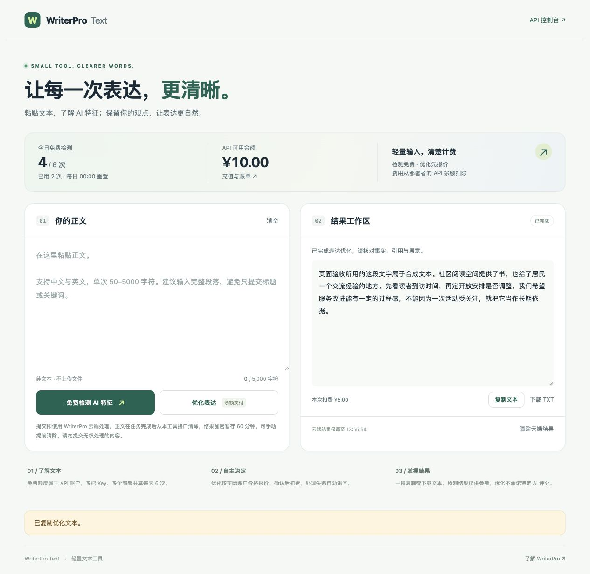

# AI Detector & AI Humanizer — WriterPro

**检测 AI 率 · 降 AI 率 · AIGC 检测 · 文章去 AI 味**

A lightweight, self-hosted **AI text detector and AI humanizer interface**, powered by the WriterPro API. Paste Chinese or English text to check an AI-generated text score, then use prepaid API credit to improve clarity and make the wording more natural.

- **AI detection:** 6 free requests per API account per day, shared across its API keys and deployments.
- **Text rewriting / AI humanizer:** review a quote before using your prepaid API balance.
- **Server-side API key:** keep your own key in `.env`; it is never sent to the browser.
- **Simple setup:** Node.js 22.11+; no third-party runtime npm dependencies.

AI detection is a model estimate, not proof of authorship. Neither 100% detection accuracy nor a specific AI score after rewriting is guaranteed.

## Quick start (English)

1. Create your own API key in the [WriterPro API Console](https://writerpro.cn/open-platform.html).
2. Download this repository, copy `.env.example` to `.env`, and set `WRITERPRO_API_KEY` on your server.
3. Run `npm start` and open [http://127.0.0.1:3080](http://127.0.0.1:3080). No `npm install` is needed.

One deployment uses one API account. All visitors share that account's free quota and balance. Internet-facing deployments require an access password and HTTPS; see the Chinese deployment guide below. This project requires a Node server and cannot run as a static GitHub Pages site.

## 中文说明：检测 AI 率与降 AI 率

一个小而完整的文本工具：**粘贴正文 → 免费检测 AI 特征 → 确认费用 → 使用 API 余额优化表达（文章去 AI 味 / 降 AI）**。

提供响应式页面和服务端转发，运行时不需要安装第三方 npm 包。适合个人使用、自托管体验和二次开发。检测、优化、账户额度和计费由 WriterPro API 提供。



_截图使用独立测试账户与合成文章；实际额度、余额和结果以你的账户为准。_

## 3 步启动

需要 **Node.js 22.11+，推荐 Node.js 24 LTS**。本项目需要运行 Node 服务，不能直接部署为 GitHub Pages 静态网页。

1. 在 [WriterPro API 控制台](https://writerpro.cn/open-platform.html)注册或登录自己的 API 账户，创建 API Key。需要优化文本时，给 **API 余额**充值。
2. 下载并解压项目，在项目目录将 `.env.example` 复制为 `.env`，填写 `WRITERPRO_API_KEY`。
3. 运行 `npm start`，打开 [http://127.0.0.1:3080](http://127.0.0.1:3080)。

```sh
cp .env.example .env
# 用本机编辑器打开 .env，填写自己的 API Key
npm start
```

Windows PowerShell 可用 `Copy-Item .env.example .env`。无需执行 `npm install`。`.env` 不应上传 GitHub；请保留项目中的 `.gitignore`。

```dotenv
WRITERPRO_API_KEY=你的_API_Key
WRITERPRO_API_BASE=https://a.writerpro.cn/text-api/v1
HOST=127.0.0.1
PORT=3080
ACCESS_PASSWORD=
PUBLIC_ORIGIN=
```

密钥只放服务端环境变量。页面没有密钥输入框，浏览器请求只到本机 `/api/*`，不会收到 API Key。

## 使用与计费

| 功能          | 规则                                                                                          |
| ------------- | --------------------------------------------------------------------------------------------- |
| AIGC 文本检测 | 每个 API 账户每日免费 6 次，北京时间 00:00 重置；超过额度停止，不自动扣款                     |
| 额度范围      | 同一账户的所有 Key、设备和部署共享；创建新 Key 或重启项目不会重置                             |
| 内容优化      | 使用该 API 账户的已充值余额；先显示报价，点击确认后才提交并扣费                               |
| 优化报价      | 沿用开放平台现行价格与账户折扣；中文计费字符/英文单词，每 1000 单位向上取整，以服务端报价为准 |
| 失败处理      | 检测失败返还预占次数；优化处理失败自动退回本次 API 余额扣款                                   |
| 正文范围      | 50–5000 字符，中英文纯文本                                                                    |
| 并发          | 每个 API 账户同时处理一个任务；服务有有界队列，满载时不扣款、不占用次数                       |
| 结果          | 检测显示模型评分；优化支持复制与 TXT 下载，不包含文件上传、PDF 报告或小程序                   |

**一次部署绑定一个 API 账户。** 访问这个部署的所有人，使用的是部署者的每日额度与余额；访问密码不等于单独的计费账户。如果要做面向公众的多用户服务，必须额外实现真实用户登录、账户映射和预算限制。

检测是模型判断，可能存在误差；不能仅凭检测结果断定作者身份、学术不端或文章真实性。优化需要人工核对事实、引用和原意，不承诺“降为 0%”或通过任何第三方检测。

## 公网部署

配置一个至少 12 位的独立访问密码，设置真实 HTTPS 域名。服务对非本机监听或公网域名会强制检查这两个配置；缺少时拒绝启动。

```dotenv
HOST=0.0.0.0
PORT=3080
ACCESS_PASSWORD=请改为至少12位的独立随机密码
PUBLIC_ORIGIN=https://text.example.com
```

在 HTTPS 反向代理中保留原始 Host，例如：

```nginx
# 放到已配置 TLS 证书的 server 块中
location / {
    proxy_pass http://127.0.0.1:3080;
    proxy_set_header Host $host;
    proxy_set_header X-Forwarded-Proto $scheme;
    client_max_body_size 40k;
    proxy_read_timeout 30s;
}
```

防火墙只开放 HTTPS 入口，Node 端口不直接对公网开放。页面使用 HttpOnly、SameSite=Strict 的会话 Cookie，公网 Cookie 加 Secure；重启服务会让登录会话失效。应用按 `PUBLIC_ORIGIN` 检查 Host 与请求来源，不信任客户端传来的转发头。

## 隐私与任务恢复

- 本项目不在本地磁盘保存正文、API 响应或用户会话；浏览器不将正文或密钥写入 localStorage/sessionStorage。
- 浏览器 sessionStorage 仅保存最近任务编号及恢复所需状态（类型、方向、已确认费用、完成状态），用于同一标签页刷新后的恢复查询；不保存正文。新标签页、不同浏览器和不同部署不会自动恢复该编号。
- WriterPro 专用接口将处理中正文加密暂存；任务完成时清除输入正文，输出结果加密保留 **60 分钟**用于恢复，也可点击“清除云端结果”提前清除。
- API 身份、用量、扣费/退款流水以及不含原文的请求去重记录，保留用于计费核对。上游模型服务的数据规则以 WriterPro 服务条款为准；本项目不承诺上游零留存。
- 网络超时不会自动创建新付费任务。页面保留原请求编号，用“查询原任务”确认结果；重复查询、相同请求重试不会再次扣费。
- 处理中的异常任务会由服务端恢复检查。优化超时或失败退回 API 余额，网络中断本身不等于已经退款，以任务状态和 API 账单为准。

## 项目结构

```text
ai-detector-ai-humanizer/
  public/          页面、样式、交互和 SVG 图标
  server.js        密钥保护、访问密码、同源校验、接口白名单
  test/            自动化测试（本地合成接口，不消耗真实额度）
  .env.example     配置示例，没有任何真实密钥
  API.md           专用接口约定与接入示例
  SECURITY.md      安全边界与密钥处理说明
  LICENSE
```

## 验证

```sh
npm run check
npm test
```

测试使用独立的本地 HTTP 合成接口，覆盖服务端密钥隔离、响应白名单、访问密码、会话退出、跨站请求、Host 校验、正文上限、路径遍历、幂等编号传递、上游超时与错误脱敏。`npm test` 不访问生产 API，也不会产生费用。

真实 API 验收：配置自己的 Key，确认剩余次数与控制台余额；提交一段合成文本做检测；优化时核对报价，再确认支付，并在 API 控制台核对账单。不要使用真实敏感材料作为验收样本。

## 常见问题

**为什么余额和网站会员不一样？** 此项目使用开放平台的 API 账户余额。网站、小程序会员和检测通行证不等于 API 余额。

**为什么只显示“请配置 API Key”？** 检查 `.env` 是否在项目根目录，Key 是否正确，然后重启 `npm start`。环境变量值只在服务启动时读取。

**已充值但仍提示余额不足？** 确认充值账户与当前 Key 所属 API 账户一致。页面报价使用实时余额，请刷新再试。

**页面刷新后还在处理？** 已提交任务由服务端继续执行，页面会查询原任务；不要另建请求来“重试支付”。结果最多保留 60 分钟。

**可以只上传 HTML 到静态空间吗？** 不可以，密钥必须由服务端保管。需要能运行 Node 服务的服务器或容器环境。

**是否需要分享自己的 API Key？** 不需要。每位下载者在自己的服务端配置自己的 Key。不要将统一公共 Key 写入仓库、README、前端构建变量或演示站代码。

## 开源范围

本仓库的页面与轻量服务端转发代码采用 MIT 许可。WriterPro 核心模型、私有计费与额度服务、支付资料、现有网站/小程序工程、品牌代理交付工程均不在本仓库中。WriterPro 名称与商标的使用权不随代码许可转让。API 调用仍遵守服务方的账户、计费和使用规则。

## 上传 GitHub

仅上传本项目目录，不要上传其上级业务工程。发布前运行 `npm test`，检查 `.env`、私钥和真实测试凭据均未跟踪。仓库中只保留 `.env.example`。下载者使用自己的 API 账户填写环境变量即可启动，无需修改页面代码。

项目不附带任何公共可用的 API Key，也没有自动发布、自动购买或自动充值逻辑。
